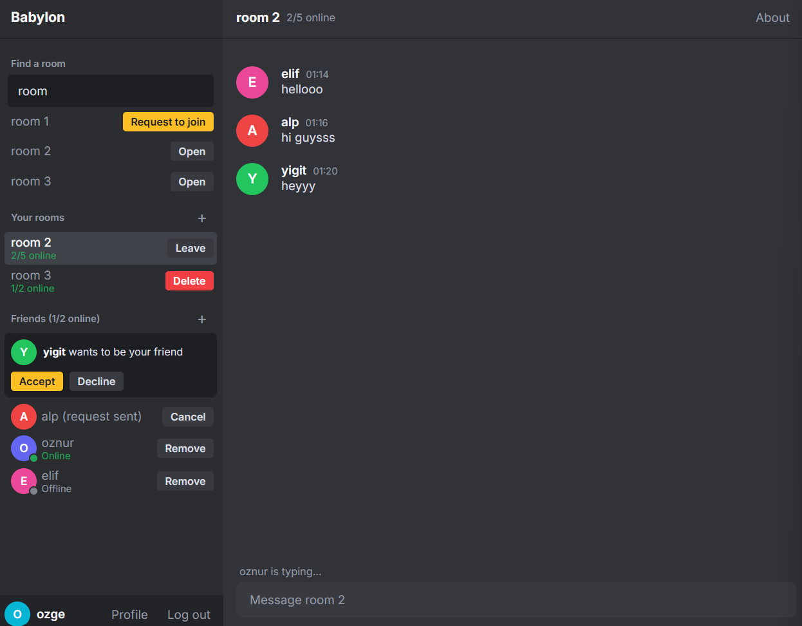
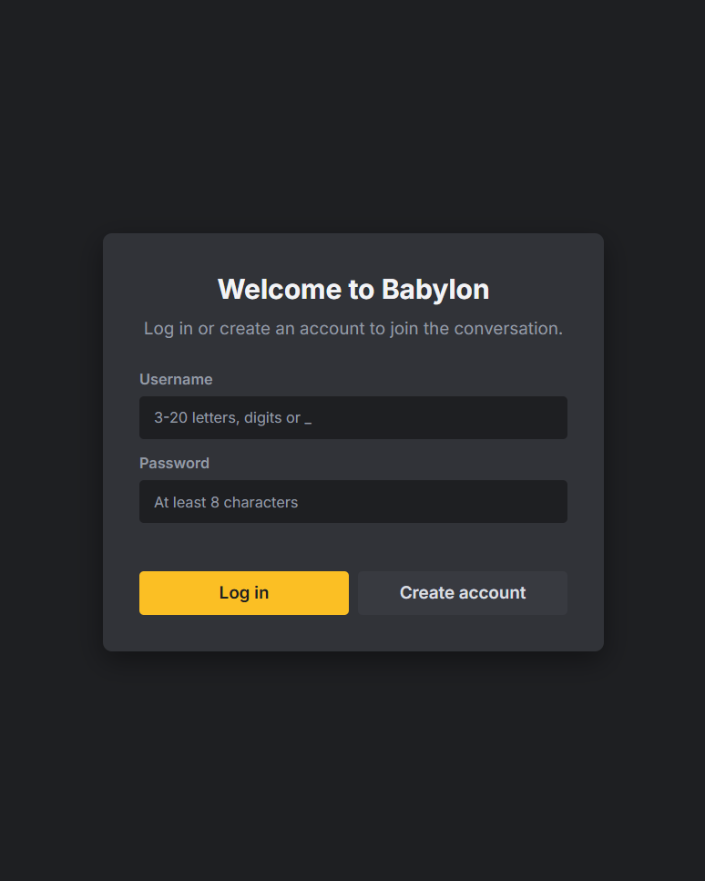
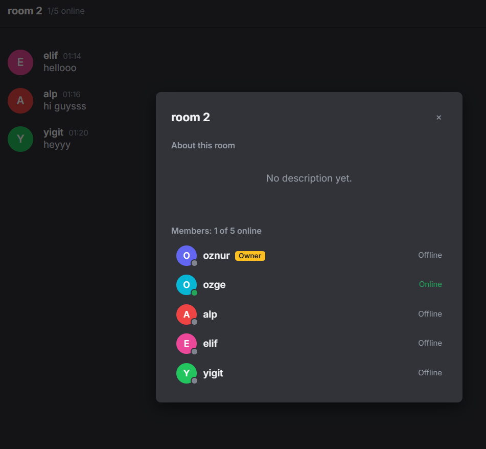
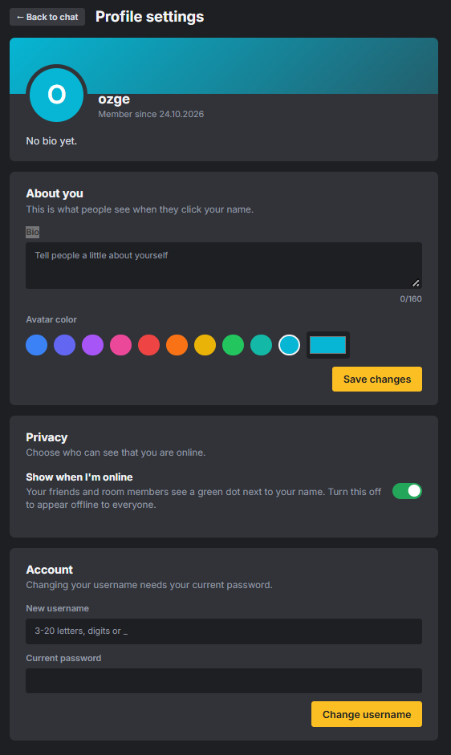

# Babylon


A real-time chat app with private rooms, friends, direct messages and presence. Built with FastAPI, WebSockets and SQLite, with a dependency-free vanilla JavaScript frontend.

**[Live demo](https://babylon-wc5a.onrender.com)**

> The demo runs on a free hosting plan: the first load can take up to a minute while the server wakes up, and data is wiped from time to time. Feel free to register and try it with a friend.



## Features

- **Accounts**: registration and login with Argon2 password hashing and JWT authentication. Usernames are unique (case-insensitive) and can be changed with the password.
- **Private rooms**: every room is invite-only. People find a room by name and send a join request, and only the owner can approve or decline it. Owners can rename or delete their room and write a description.
- **Friends**: send, accept and remove friend requests.
- **Direct messages**: one-to-one chats, available only between friends. They are modeled as hidden two-person rooms, so they share the same message pipeline as rooms.
- **Presence**: see which friends and room members are online, with a privacy switch to appear offline.
- **Typing indicators** and **unread badges** for rooms and direct chats, also shown in the browser tab title.
- **Profiles**: bio and avatar color.
- **Responsive UI**: a Discord-style dark theme with a yellow accent that also works on phones.

| Login | Room details | Profile settings |
| --- | --- | --- |
|  |  |  |

## Tech stack

| Layer | Choice |
| --- | --- |
| API and WebSockets | FastAPI, Uvicorn |
| Database | SQLite via SQLAlchemy 2.x |
| Auth | PyJWT, pwdlib (Argon2) |
| Frontend | One `index.html`, vanilla JS, no build step |
| Tests | pytest, FastAPI `TestClient` (including WebSockets) |
| Deployment | Docker, Render |

## Getting started

```bash
git clone https://github.com/olcekciozge/Babylon.git
cd Babylon
python -m venv .venv
# Windows: .venv\Scripts\activate    macOS/Linux: source .venv/bin/activate
pip install -r requirements.txt
uvicorn app.main:app --reload
```

Open <http://localhost:8000>, create a few accounts and try it out. To be logged in as several people at once, use different browsers or private windows.

### With Docker

```bash
docker build -t babylon .
docker run -p 8000:8000 -e SECRET_KEY=change-me babylon
```

### Configuration

| Variable | Default | Purpose |
| --- | --- | --- |
| `SECRET_KEY` | insecure dev value | Signs the JWT tokens. **Set your own in production.** Generate one with `python -c "import secrets; print(secrets.token_hex(32))"`. |
| `DATABASE_URL` | `sqlite:///./babylon.db` | Database connection string. |
| `PORT` | `8000` | Port used by the Docker image. |

## Running the tests

```bash
pip install -r requirements-dev.txt
pytest
```

The suite has 42 tests covering authentication, profiles, rooms and join requests, friends, direct messages, WebSocket messaging, typing events, presence and unread counts. Each test run uses a fresh temporary SQLite database, and the tests run automatically on every push with GitHub Actions.

## How it works

- **Real time.** Each room has a set of open WebSocket connections held by a `ConnectionManager`. A message is validated, saved, and only then broadcast, so what users see is what is stored. A separate `/presence` socket per user carries online status and "new message" notifications for chats the user is not looking at.
- **Authorization on the server.** Tokens are checked before a WebSocket is accepted, membership is checked before joining a room, and owner-only actions go through one helper. Direct chats re-check the friendship on every message, and unfriending or deleting a room closes the open sockets.
- **Unread counts.** A per-user, per-chat `last_read_id` marker. Counting messages after the marker (excluding your own) keeps the badge consistent across devices and reloads.
- **Safe rendering.** All user content is inserted with `textContent`, never `innerHTML`.

```
app/
  main.py        app setup, chat and presence WebSockets
  auth.py        register, login, token handling
  users.py       profile, username change, privacy
  rooms.py       rooms, search, join requests, messages
  friends.py     friend requests
  dms.py         direct messages
  unread.py      unread counters
  manager.py     per-room WebSocket connections
  presence.py    online status
  models.py      SQLAlchemy models
static/index.html    the whole frontend
tests/               pytest suite
Dockerfile           container image
```

## Known limitations

- Presence and WebSocket connections live in the memory of one process, so the app runs as a single instance. Scaling out would need a shared pub/sub layer such as Redis.
- Schema changes use a small startup helper (`add_missing_columns`). A larger project would use Alembic migrations.
- The sidebar refreshes by polling every 10 seconds, apart from the instant WebSocket notifications.
- No message editing, deletion or attachments. Read receipts are left out on purpose: unread badges and typing indicators cover the need without social pressure.

## Roadmap

- Voice and video calls with WebRTC
- Persistent database for the hosted demo